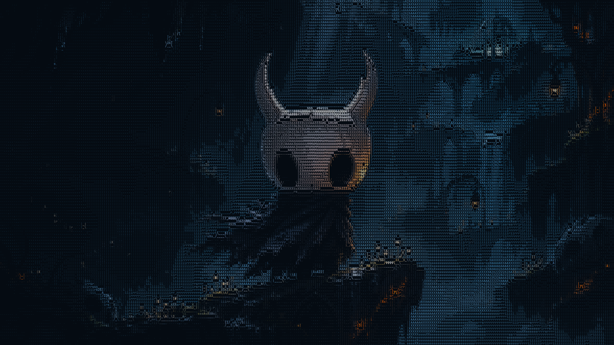
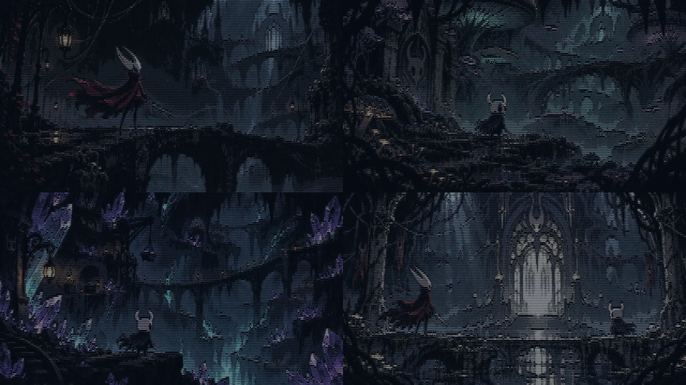

# Hollow Knight ASCII for Omarchy

An unofficial Hallownest inspired Omarchy theme with five detailed wallpapers rendered entirely from 320 × 116 colored ASCII characters. The palette uses deep blue black, pale bone, muted cyan, and small amber accents.





## Install

Install from GitHub with Omarchy:

```sh
omarchy theme install https://github.com/rcode010/omarchy-hollow-knight-ascii-theme.git
```

Omarchy derives the theme name `hollow-knight-ascii` from this repository's name and applies it during installation. Later, run `omarchy theme set hollow-knight-ascii` to return to it.

## Files

- `colors.toml` — Omarchy palette
- `backgrounds/` — five 2560 × 1440 ASCII wallpapers: Hallownest, Hornet's silk bridge, the fungal cavern, the crystal mine, and Hornet with the Knight at the palace gate
- `preview.png` — 1600 × 900 theme preview
- `ascii/` — plain ASCII character versions of every scene

The wallpapers were made by converting AI assisted fantasy illustrations into colored ASCII glyphs. Every visible feature in the final wallpaper images is rendered as text; the source illustrations are absent from the wallpaper images.

This is fan made and is not affiliated with Team Cherry. Hollow Knight and its characters belong to Team Cherry.
